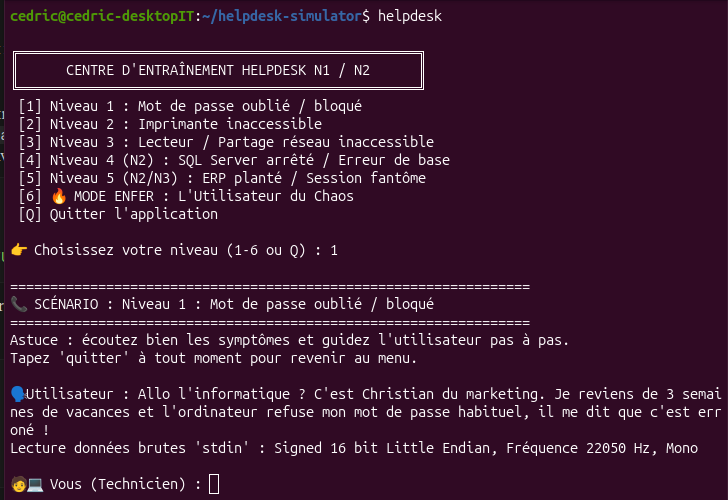

# 📞 Helpdesk Simulator — Simulateur Vocal d'Appels Support N1/N2 (CLI & IA Locale)

[](https://www.python.org/)
[](https://ollama.com/)
[](https://github.com/rhasspy/piper)
[](https://www.axelos.com/certifications/itil-service-management)
[](LICENSE)

**Helpdesk Simulator** est un outil d'entraînement interactif en ligne de commande destiné aux techniciens support informatique (Helpdesk N1/N2 / TSSR).

Il simule des appels téléphoniques réalistes avec des utilisateurs en détresse, incarnés par un LLM local (Llama 3.2) et doublés vocalement par Piper TTS. Le technicien doit mener l'enquête, pratiquer l'écoute active, appliquer la méthode de l'entonnoir et diagnostiquer la panne **sans jargon technique**.

---

## 🎯 Compétences IT & pédagogie

Ce simulateur a été développé pour travailler deux aspects cruciaux du métier de technicien :

- **Hard skills** : diagnostic méthodique basé sur le modèle OSI (couche 1 physique, couches 3/4 réseau, couche 7 applicative), services Windows, bases SQL, droits d'accès.
- **Soft skills** : gestion du stress utilisateur, reformulation, exclusion du jargon face aux non-techniciens, patience et respect des procédures de clôture ITIL.

## 🕹️ Scénarios & niveaux de difficulté

| Niveau | Titre | Problématique technique sous-jacente | Objectif pédagogique |
|:---:|---|---|---|
| 1 | Mot de passe oublié | Touche Verr Maj (Caps Lock) active au retour de congés | Identification rapide, déblocage sans réinitialisation superflue |
| 2 | Imprimante inaccessible | Mauvaise imprimante par défaut (Print to PDF sélectionnée) | Guidage dans l'interface Windows sans prise en main distante |
| 3 | Lecteur réseau déconnecté | Déconnexion de session SMB (lecteur `Z:`) après bail DHCP | Diagnostic du chemin UNC (`\\serveur\partage`), test `ping` |
| 4 (N2) | SQL Server arrêté | Service Windows `MSSQLSERVER` arrêté (port 1433 injoignable) | Analyse de code d'erreur applicatif, services distants |
| 5 (N2) | ERP verrouillé | Processus orphelin et fichier de verrou (`.lck`) après crash | Gestionnaire des tâches, sessions fantômes, bases de données |
| 6 🔥 | **MODE ENFER : Utilisateur du Chaos** | Câble souris débranché sous le bureau + dossiers sur le clavier | Gestion d'un VIP en panique, mauvaise foi, filtrage du bruit |

## 🏗️ Architecture technique

- **Moteur d'IA conversationnelle** : Ollama (`llama3.2:3b`) avec des prompts système à contraintes strictes (réponses courtes, résistance au diagnostic, déclencheurs précis de résolution).
- **Moteur de synthèse vocale (TTS)** : Piper avec la voix française `siwis`.
- **Interface** : CLI interactive Python, avec l'historique de conversation injecté dynamiquement dans le contexte du modèle.
- **Souveraineté des données** : 100 % local, aucun appel à des API externes payantes.

## 🚀 Installation & démarrage

### 1. Prérequis

- Un système Linux (Ubuntu/Debian) avec Python 3 et `aplay` (ALSA).
- Ollama installé avec le modèle Llama 3.2 :

```bash
ollama pull llama3.2:3b
```

### 2. Cloner et installer les dépendances

```bash
git clone https://github.com/cedricboucard/helpdesk-simulator.git
cd helpdesk-simulator
python3 -m venv venv
source venv/bin/activate
pip install -r requirements.txt
```

### 3. Voix Piper

Le projet nécessite le binaire Piper et le modèle ONNX dans le répertoire local (ou via des liens symboliques vers votre installation centrale) :

```bash
# Vérifier la présence des dossiers models/ et piper/
ls -lh models/fr_FR-siwis-medium.onnx
```

### 4. Lancer le simulateur

```bash
python simulateur_helpdesk.py
```

## 📄 Licence

Distribué sous licence MIT. Conçu pour la formation des techniciens support et administrateurs systèmes.

## 📸 Aperçu


